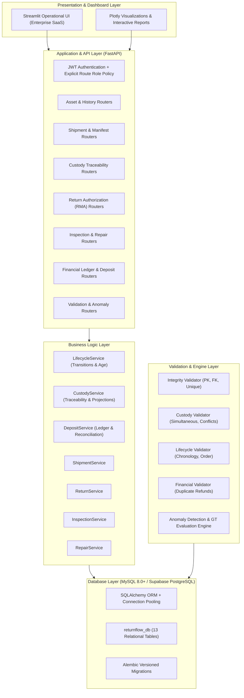
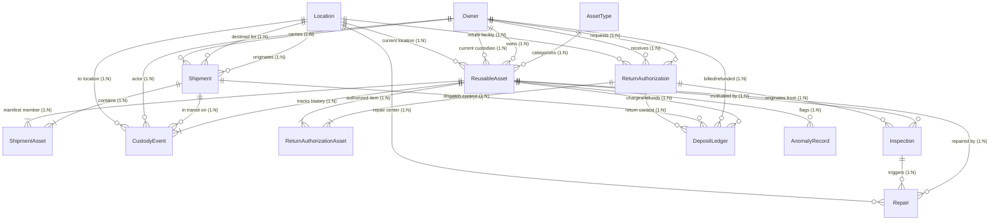

# ReturnFlow Architecture Documentation

## 1. System Overview

**ReturnFlow** is an enterprise data-driven software solution designed to coordinate reusable packaging, pallets, transport crates, equipment, custody transfers, returns, inspections, repairs, and financial deposits across supply chain networks.

### Layered Architectural Model

---

## 2. Entity-Relationship Diagram (ERD)

---

## 3. Data Integrity & Traceability Principles

1. **Append-Only Historical Custody:**
   State changes, transfers, dispatches, and arrivals are appended as immutable `CustodyEvent` records. Historical records are never silently updated or overwritten when an asset moves.
2. **Materialized State Projection:**
   `current_location_id`, `current_custodian_owner_id`, `asset_status`, and `last_event_at` on `ReusableAsset` serve as a read-optimized materialized projection. The system provides `CustodyService.rebuild_asset_projection_from_events()`, which replays custody events plus recorded legacy inspections/repairs and reports incomplete histories without inventing events.
3. **Signed Deposit Liability Ledger:**
   Deposits are treated with signed decimal accounting. Initial deposits are positive liabilities (`DEPOSIT_CHARGE`); refunds are recorded as negative transactions (`DEPOSIT_REFUND`). Duplicate refunds and over-refunds are blocked at both the service and validator layer.
4. **Relational Constraints:**
   Foreign key relationships are strictly maintained using InnoDB / PostgreSQL foreign key constraints with indexed lookup columns to support high-throughput lookups across 20,000+ assets.

---

## 4. Verified boundaries and planned integrations

Verified here: FastAPI + SQLAlchemy + MariaDB 10.11.14, JWT authentication, guarded business routers, explicit four-role policy, in-process validation, and an authenticated Streamlit gate. The portal continues to use the existing HTML/CSS/JavaScript layout.

Supabase/PostgreSQL, external Better Auth, Fly.io, Cloudflare Pages and production telemetry are not established by configuration variables. A production Dockerfile and deployed integrations were not verified. Do not describe these as implemented deployments.

## 5. Repair architecture notes

Persistent ID allocation uses an upsert followed by a row lock, initializes from existing business identifiers, and joins the business transaction. Migrations, not request handlers, create schema.

`atomic_operation` gives live service operations a savepoint; route boundaries commit. `record_transition` centralizes state-machine validation and event/projection writes. Domain facts for inspection and repair are not fabricated physical transfers. Raw custody creation cannot bypass shipment/return/inspection/repair prerequisites. New registrations start AVAILABLE.

The read-only projection service combines explicit domain events with legacy inspection/repair facts when an equivalent domain event is absent. Equal timestamps use deterministic record ordering. Legacy missing movement/post-repair evidence is reported; no self-healing job mutates the archive.

Financial reconciliation includes obligation-level checks, not just a portfolio equation. Unique transaction references provide durable idempotency; explicit original-deposit links take precedence and ambiguous legacy links fail closed.
